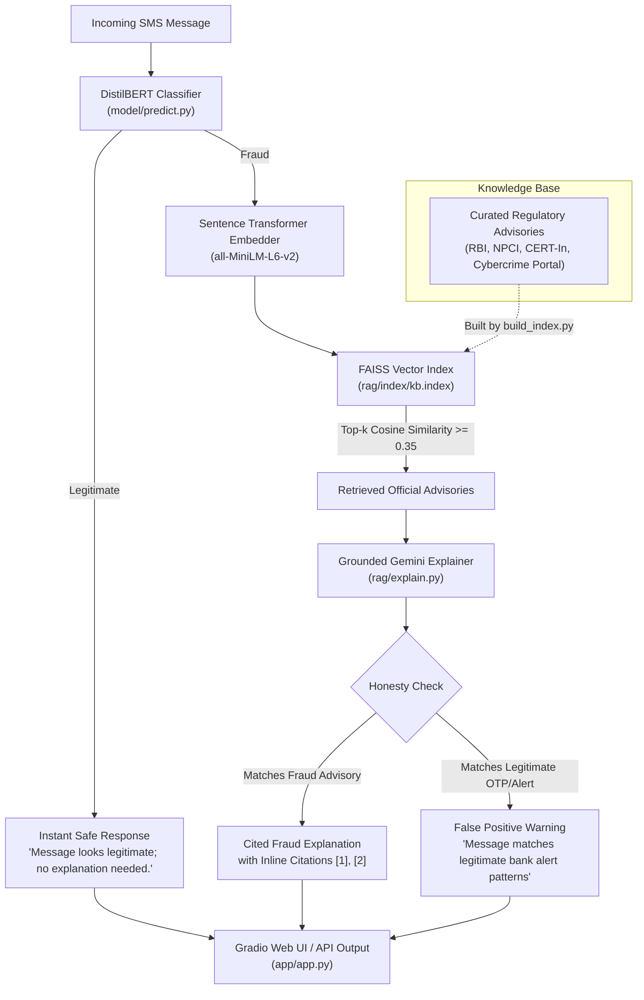

# 🛡️ Fraud Message Detection and Grounded Explanation Pipeline

[](https://www.python.org/)
[](https://pytorch.org/)
[](https://huggingface.co/)
[](https://huggingface.co/distilbert-base-uncased)
[](https://github.com/facebookresearch/faiss)
[](https://aistudio.google.com/)
[](https://gradio.app/)

An end-to-end artificial intelligence security pipeline for detecting fraudulent SMS messages (smishing) and generating **factually grounded, cited explanations**. 

The system pairs a fine-tuned **DistilBERT** neural classifier (**99.42% accuracy**, **97.74% F1-score**) with a **Retrieval-Augmented Generation (RAG)** pipeline. When a suspicious message is flagged, the pipeline retrieves official cyber-fraud advisories from authoritative Indian regulatory bodies (**RBI**, **NPCI**, **Cybercrime Portal**, **CERT-In**) using a local **FAISS** vector store, then uses **Google Gemini** to produce a concise, cited explanation with an explicit **false-positive honesty safeguard** for authentic bank alerts.

---

## 📌 Table of Contents

- [Problem Statement & Motivation](#-problem-statement--motivation)
- [System Architecture](#-system-architecture)
- [Key Features](#-key-features)
- [Dataset & Preprocessing](#-dataset--preprocessing)
- [Model Training & Experimental Results](#-model-training--experimental-results)
- [Grounded Explanation Pipeline (RAG)](#-grounded-explanation-pipeline-rag)
- [Project Directory Structure](#-project-directory-structure)
- [Quickstart & Installation Guide](#-quickstart--installation-guide)
- [Interactive Gradio Web Application](#-interactive-gradio-web-application)
- [Benchmark Evaluation & Sample Outputs](#-benchmark-evaluation--sample-outputs)
- [Contributors](#-contributors)

---

## 🎯 Problem Statement & Motivation

Mobile users increasingly face sophisticated smishing attacks—urgent messages threatening bank account suspension due to pending KYC, immediate electricity disconnection, fake lottery prizes, and deceptive work-from-home task schemes.

Traditional SMS spam detectors exhibit two major shortcomings:
1. **The "Black Box" Problem:** They output a binary label (`fraud` vs. `legitimate`) without explaining *why* the message is unsafe, leaving users uninformed.
2. **The False-Positive Dilemma:** Genuine bank transaction alerts and OTP messages often contain high-risk keywords (*"OTP"*, *"INR"*, *"bank"*, *"account"*, *"blocked"*), leading classifiers to misclassify legitimate communications.

### Our Solution
A two-stage defensive framework:
- **Stage 1 (High-Precision Classification):** A lightweight, fine-tuned DistilBERT transformer rapidly categorizes incoming text into legitimate or fraudulent messages.
- **Stage 2 (Grounded Explanation via RAG):** For flagged messages, semantic vector search retrieves relevant verified advisories from Indian financial and cyber authorities. Google Gemini then synthesizes a verified explanation with inline citations (`[1]`, `[2]`), adhering to an honesty rule that explicitly identifies potential classifier false positives if the text exhibits legitimate bank notification traits.

---

## 🏗️ System Architecture



---

## ✨ Key Features

- **High-Performance Transformer Classifier:** DistilBERT achieves **99.42% accuracy** and **97.74% F1-score**, outperforming traditional TF-IDF + Logistic Regression baselines.
- **Hardware-Aware Acceleration:** Automatic device selection across **Apple Silicon (MPS)**, **NVIDIA (CUDA)**, and **CPU**.
- **Local Dense Semantic Search:** 384-dimensional `all-MiniLM-L6-v2` embeddings indexed with **FAISS `IndexFlatIP`** (Inner Product / Cosine Similarity) running entirely offline with zero API latency.
- **Reduced hallucination: the explanation is restricted to retrieved advisory notes.** Gemini 3.5 Flash operates under strict prompt constraints, generating explanations restricted strictly to retrieved advisory text with inline bracket citations `[1]`, `[2]`.
- **False-Positive Honesty Mechanism:** Explicit knowledge base entries (`kb13`, `kb14`) define characteristics of authentic OTPs, enabling the LLM to countermand false alarms from the classifier.
- **Interactive Gradio Web Interface:** Real-time web UI featuring preset test cases, confidence meters, formatted markdown explanations, and clickable links to official advisories.
- **Reproducible Benchmark Suite:** Automated benchmark script evaluating 5 critical smishing and legitimate communication categories.

---

## 📊 Dataset & Preprocessing

The classification model was trained on the **UCI SMS Spam Collection** dataset, preprocessed via `model/prepare_data.py`:

1. **Automated Ingestion:** Directly fetched and extracted from the official UCI machine learning repository.
2. **De-duplication:** Removed duplicate SMS instances to eliminate data leakage between training and testing splits (reducing 5,574 raw records to **5,171 unique messages**).
3. **Stratified Splitting:** Partitioned using an **80 / 10 / 10** split with `random_state=42`, preserving class balance (~87.3% Ham, ~12.7% Spam/Fraud) across all subsets.

| Split | Percentage | Total Messages | Legitimate (Ham / 0) | Fraud (Spam / 1) |
| :--- | :---: | :---: | :---: | :---: |
| **Train** | 80% | 4,136 | 3,614 (87.38%) | 522 (12.62%) |
| **Validation** | 10% | 517 | 452 (87.43%) | 65 (12.57%) |
| **Test** | 10% | 518 | 452 (87.26%) | 66 (12.74%) |
| **Total** | **100%** | **5,171** | **4,518 (87.37%)** | **653 (12.63%)** |

---

## 🔬 Model Training & Experimental Results

### Baseline vs. DistilBERT Comparison

We evaluated two distinct architectures on the identical unseen test set (518 messages):
1. **Baseline Model:** TF-IDF n-gram vectorization paired with Logistic Regression (`class_weight='balanced'`).
2. **Transformer Model:** `distilbert-base-uncased` fine-tuned for 3 epochs using PyTorch and Hugging Face Transformers.

| Metric (Fraud Class = 1) | Baseline (TF-IDF + LogReg) | Fine-Tuned DistilBERT | Relative Improvement |
| :--- | :---: | :---: | :---: |
| **Accuracy** | 97.88% | **99.42%** | **+1.54%** |
| **Precision** | 88.73% | **97.01%** | **+8.28%** |
| **Recall** | 95.45% | **98.48%** | **+3.03%** |
| **F1-Score** | 91.97% | **97.74%** | **+5.77%** |

### DistilBERT Hyperparameters
- **Base Architecture:** `distilbert-base-uncased` (66M parameters)
- **Epochs:** 3
- **Batch Size:** 16
- **Max Sequence Length:** 128 tokens
- **Optimizer:** AdamW (`learning_rate = 2e-5`)
- **Loss Function:** Cross-Entropy Loss
- **Artifacts Saved:**
  - Loss curve: [model/results/loss_curve.png](model/results/loss_curve.png)
  - Confusion matrix: [model/results/confusion_matrix.png](model/results/confusion_matrix.png)
  - Misclassified analysis: [model/results/misclassified_examples.csv](model/results/misclassified_examples.csv)
  - Trained weights: [model/saved_model/](model/saved_model/)

---

## 🧠 Grounded Explanation Pipeline (RAG)

When a message is flagged as fraud, explanation generation proceeds through three coordinated stages:

### 1. Curated Knowledge Base (`rag/knowledge_base.json`)
Contains 15 verified fraud advisories sourced directly from:
- **Reserve Bank of India (RBI):** *BE(A)WARE Booklet on Modus Operandi of Financial Frauds*
- **National Payments Corporation of India (NPCI):** *UPI Safety Guidelines*
- **National Cyber Crime Reporting Portal (`cybercrime.gov.in`):** *Citizen Financial Fraud Advisories*
- **CERT-In (Indian Computer Emergency Response Team):** *Phishing & Smishing Bulletins*

Advisories address threat categories including **Fake KYC updates**, **Urgent utility / electricity disconnection**, **Part-time work/YouTube task scams**, **Lottery / lucky draw phishing**, **Unregistered instant loan apps**, and **Authentic OTP alert characteristics**.

### 2. FAISS Semantic Retrieval (`rag/retriever.py`)
- Employs `all-MiniLM-L6-v2` to generate 384-dimensional dense vectors.
- Embeddings are L2-normalized so inner product computation directly yields **cosine similarity**.
- Employs a strict similarity threshold of **`0.35`**: queries with top match scores below this threshold return no notes, preventing irrelevant retrievals.

### 3. Grounded LLM Explainer (`rag/explain.py`)
- Utilizes Google Gemini (`gemini-3.5-flash`) via the official `google-genai` SDK.
- Prompt constraints enforce:
  - Reduced hallucination: the explanation is restricted to retrieved advisory notes.
  - Inline bracket citations matching retrieved advisory numbers (`[1]`, `[2]`).
  - Strict brevity (< 120 words in plain English).
  - **Honesty Rule:** If notes reveal authentic notification patterns (e.g., standard bank OTP without phishing links), the model explicitly reports that the message does not match fraud advisories and notes the classifier likely registered a false positive.

---

## 📁 Project Directory Structure

```
fraud-message-detection/
├── app/
│   ├── __init__.py
│   ├── app.py                     # Interactive Gradio web interface
│   └── pipeline.py                # Unified analyze() pipeline (Classifier + RAG)
├── data/
│   ├── train.csv                  # 80% Stratified training set (4,136 samples)
│   ├── val.csv                    # 10% Stratified validation set (517 samples)
│   └── test.csv                   # 10% Stratified test set (518 samples)
├── docs/
│   └── pallavi_readme_section.md  # Track B module documentation
├── model/
│   ├── __init__.py
│   ├── prepare_data.py            # Downloads UCI data, deduplicates, and splits
│   ├── baseline.py                # TF-IDF + Logistic Regression baseline
│   ├── train_distilbert.py        # DistilBERT fine-tuning script
│   ├── predict.py                 # Standalone inference API with model caching
│   ├── saved_model/               # Saved fine-tuned DistilBERT weights & config
│   │   ├── config.json
│   │   ├── model.safetensors
│   │   ├── tokenizer.json
│   │   └── tokenizer_config.json
│   └── results/
│       ├── baseline_metrics.json  # TF-IDF baseline evaluation results
│       ├── distilbert_metrics.json# DistilBERT evaluation results
│       ├── loss_curve.png         # Training vs. validation loss curve plot
│       ├── confusion_matrix.png   # DistilBERT test confusion matrix plot
│       └── misclassified_examples.csv # Test set error analysis
├── rag/
│   ├── __init__.py
│   ├── knowledge_base.json        # 15 curated regulatory fraud advisories
│   ├── build_index.py             # Encodes notes and creates FAISS index
│   ├── retriever.py               # Top-k FAISS semantic search (cosine >= 0.35)
│   ├── explain.py                 # Grounded Gemini explanation generator
│   └── index/                     # Generated FAISS vector index & metadata (git-ignored)
├── samples/
│   ├── run_samples.py             # 5-case benchmark evaluation script
│   ├── sample_outputs.json        # Raw benchmark evaluation results
│   └── sample_outputs.md          # Formatted benchmark evaluation report
├── .env.example                   # Template for environment variables (API keys)
├── .gitignore                     # Git ignore rules
├── requirements.txt               # Unified project dependencies
└── README.md                      # Comprehensive project documentation
```

---

## 🚀 Quickstart & Installation Guide

### 1. Prerequisites
- Python 3.10 or higher installed
- Git installed
- A Google Gemini API key (obtainable free from [Google AI Studio](https://aistudio.google.com/))

### 2. Clone Repository & Setup Virtual Environment

```bash
# Clone the repository
git clone https://github.com/Rishika-Batra/fraud-message-detection.git
cd fraud-message-detection

# Create a virtual environment
python3 -m venv .venv

# Activate the virtual environment
# On macOS / Linux:
source .venv/bin/activate
# On Windows (PowerShell):
.\.venv\Scripts\Activate.ps1
```

### 3. Install Dependencies

```bash
pip install --upgrade pip
pip install -r requirements.txt
```

### 4. Configure Environment Variables

Create your local `.env` configuration from the provided template:

```bash
cp .env.example .env
```

Open `.env` and set your Gemini API key:
```env
GEMINI_API_KEY=your_actual_gemini_api_key_here
```

### 5. Build the FAISS Semantic Index

Generate the local vector index from `rag/knowledge_base.json`:

```bash
python rag/build_index.py
```
*Output: Saves index files to `rag/index/kb.index` and `rag/index/metadata.json`.*

### 6. (Optional) Reproduce Data Preparation & Model Training

To rebuild datasets and train models from scratch:

```bash
# Download and partition UCI dataset
python model/prepare_data.py

# Train baseline Logistic Regression
python model/baseline.py

# Fine-tune DistilBERT on CUDA / Apple Silicon MPS / CPU
python model/train_distilbert.py
```

---

## 💻 Running Inference

### Quick Terminal Prediction (Classifier Only)

```bash
python model/predict.py "Dear customer, your bank account is suspended due to pending KYC. Click http://bit.ly/update to verify."
```

*Output:*
```json
{"label": "fraud", "confidence": 0.9984}
```

### Full Pipeline Analysis (Classifier + RAG Explanation)

```bash
python app/pipeline.py "URGENT: Your electricity power supply will be disconnected tonight at 9:30 PM. Call officer at 9876543210."
```

---

## 🌐 Interactive Gradio Web Application

Launch the browser-based graphical user interface:

```bash
python app/app.py
```

Open your browser at: **`http://127.0.0.1:7860`**

### UI Features:
- **Instant Interactive Analysis:** Paste any custom SMS or WhatsApp message.
- **Preset Demonstration Examples:** One-click presets covering KYC fraud, utility threats, work-from-home scams, legitimate chats, and authentic bank alerts.
- **Visual Confidence Metrics:** Displays classification label with high-visibility badge and percentage confidence score.
- **Cited Markdown Explanations:** Explanations cite verified authorities inline (`[1]`, `[2]`).
- **Official Advisory Links:** Direct clickable URLs to regulatory releases (RBI, NPCI, Cybercrime Portal).

---

## 🧪 Benchmark Evaluation & Sample Outputs

Run the automated evaluation benchmark across 5 canonical scenarios:

```bash
python samples/run_samples.py
```

Results are logged in both [samples/sample_outputs.json](samples/sample_outputs.json) and [samples/sample_outputs.md](samples/sample_outputs.md).

### Summary of Benchmark Results

| Scenario | Input Message Excerpt | Classifier Label | Confidence | Top FAISS Score | Explanation Summary |
| :--- | :--- | :---: | :---: | :---: | :--- |
| **SAMPLE_01: KYC Phishing** | *"SBI bank account suspended... pending KYC verification. Click bit.ly link"* | `FRAUD` | 99.8% | 0.5871 | Cites RBI advisory on fake KYC SMS and malicious shortlinks `[1]`. |
| **SAMPLE_02: Utility Threat** | *"Electricity power disconnected tonight at 9:30 PM... Call officer at 9876543210"* | `FRAUD` | 99.9% | 0.5656 | Identifies power cut extortion tactics and personal number solicitation `[1]`. |
| **SAMPLE_03: Task Scam** | *"Earn Rs 2500 - 5000 per day by rating Google map locations & liking YouTube videos"* | `FRAUD` | 99.9% | 0.3585 | Matches high-return part-time task fraud modus operandi `[1]`. |
| **SAMPLE_04: Casual Chat** | *"Hey, are we meeting at the campus library at 4 PM?"* | `LEGITIMATE` | 99.6% | — | Bypasses RAG: *"Message looks legitimate; no explanation needed."* |
| **SAMPLE_05: Genuine Bank OTP** | *"482910 is your secret OTP for transaction of INR 1,500.00 at Flipkart... Never share OTP"* | `FRAUD` | 99.9% | 0.4749 | **Honesty Triggered:** Recognizes authentic OTP characteristics; flags classifier false positive. |

---

## 👥 Contributors

- **Rishika Batra** — *Data Pipeline, TF-IDF Baseline, DistilBERT Fine-Tuning & Evaluation, Model Inference API*
- **Pallavi** — *RAG Knowledge Base Curation, FAISS Semantic Indexing, Grounded Gemini Explainer, Gradio Web UI, Benchmark Suite*
- **Rishabh** — *Presentation, project report and final submission*

---

## 📜 License

This project was developed for academic research and educational evaluation. Datasets and regulatory advisories remain the property of their respective originators (UCI Machine Learning Repository, Reserve Bank of India, NPCI, CERT-In).
